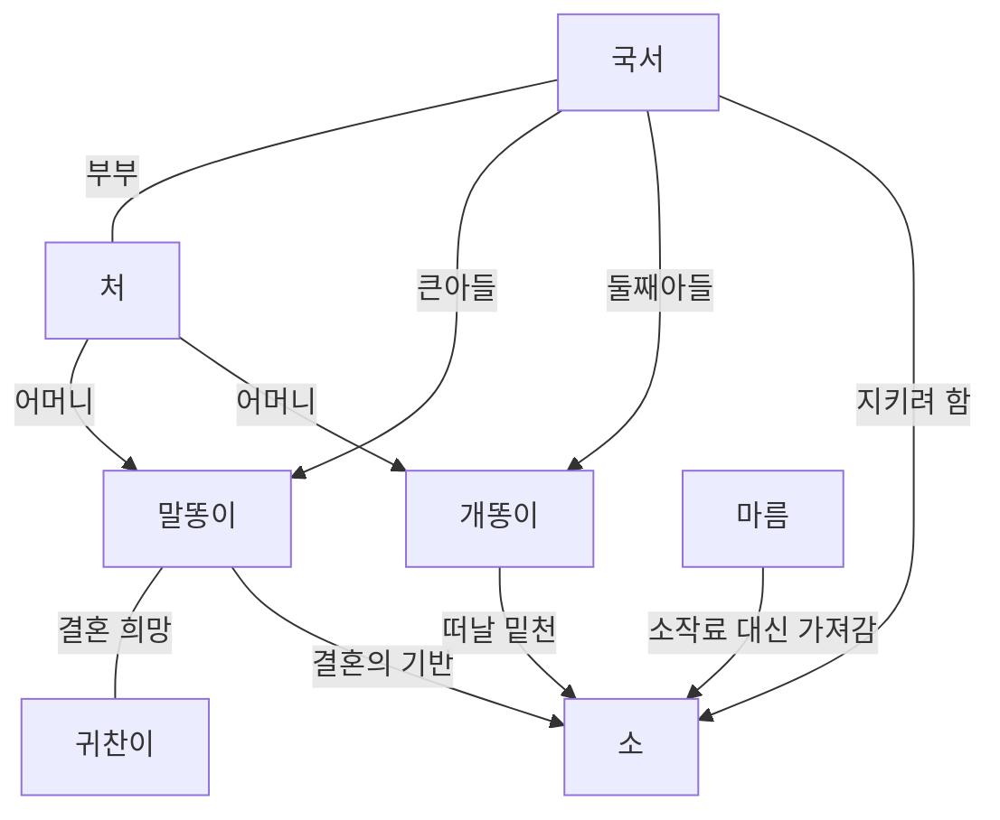

# 소 — 유치진

> [!abstract] 시험 직전 요약
> - **한 문장 줄거리:** 소 한 마리에 각자의 미래를 걸었던 농민 가족이 소작 제도의 압박 속에서 희망을 잃는 이야기.
> - **핵심 질문:** 내가 가진 것을 내 뜻대로 쓸 수 없다면, 내 미래는 누가 결정하는가?
> - **연기의 출발점:** 각 인물이 지금 상대에게 얻으려는 것을 구체적으로 잡는다.

> [!info] 이 노트의 범위
> 기관 자료와 연구논문을 확인해 만든 분석 초안이다. **줄거리·인물의 기본 정보**와 **연기를 위한 해석·제안**을 구분했다. 대본 전체를 대조하지 않았으므로 막별 세부 순서와 정확한 지문은 사용 판본에 맞춰 보완한다. 개똥이 장면은 기존 [[소 - 개똥이]] 연습 노트를 기준으로 삼았다.

| 항목 | 내용 |
|---|---|
| 작품명·작가 | 「소」(牛), 유치진 |
| 발표 | 1935년 1월 30일~2월 22일, 『동아일보』 연재 |
| 구성 | 3막 장막극 |
| 배경·성격 | 1930년대 농촌을 다룬 사실주의 희곡 |
| 일본 초연 | 1935년 6월 4일, 동경학생예술좌, 츠키지 소극장 |
| 한국 초연 | 1937년 2월 25~28일, 극예술연구회, 부민관. 「풍년기」로 개작하여 공연 |

발표·초연 연표는 [국립극단 작품 기록](https://archive.ntck.or.kr/front/view/work/W000116), 발표 지면은 [이정숙의 2019년 연구](https://www.kci.go.kr/kciportal/landing/article.kci?arti_id=ART002541138), 구성과 배경은 [서울대학교 희곡집 해제](https://rarebook.snu.ac.kr/advance-search/detail/?cid=3091793&mmsid=99136793202591)를 기준으로 했다. 한국 공연은 검열로 한 차례 무산된 뒤 개작 공연으로 이어졌으므로 **발표, 일본 초연, 한국 초연을 구분**해 기억한다.

## 작가 소개

유치진(1905~1974, 호 동랑)은 통영 출신 극작가·연출가다. 1931년 극예술연구회 조직에 참여했고, 「토막」·「빈민가」·「소」 등에서 가난과 식민지 현실을 다뤘다. 이후 드라마센터 건립 등 연극 교육과 활동 기반 마련에도 관여했다.

그의 이력에는 일제 말기 친일 연극 활동도 포함된다. 초기 작품의 현실 비판과 작가의 이후 행적을 함께 검토해야 하며, 「소」 한 편으로 작가 생애 전체를 항일적으로 규정하지 않는다. [출처: 「유치진」 — 한국민족문화대백과사전](https://encykorea.aks.ac.kr/Article/E0041924)

## 전체 줄거리

### 전체 줄거리

소작농 국서는 소를 아낀다. 큰아들 말똥이는 빚 때문에 팔려갈 처지인 귀찬이와 결혼하고 싶어 하고, 둘째 개똥이는 소를 팔아 만주로 갈 밑천을 마련하려 한다. 가족은 같은 재산에 서로 다른 기대를 건다.

소를 담보로 귀찬이네 빚을 해결할 가능성이 생기자 말똥이는 활기를 되찾는다. 그러나 마름이 밀린 소작료 대신 소를 가져가면서 희망이 무너진다. 말똥이는 결국 지주 집 곳간에 불을 지른다. 사건의 핵심은 [이정숙(2010), 135~140쪽](https://journal.kci.go.kr/kdrama/archive/articlePdf?artiId=ART001489158)을 바탕으로 요약했다.

### 짧은 요약

가족 내부의 재산 다툼이 농민의 생계를 좌우하는 권력의 문제로 확대된다. 개인의 노력과 가족 간 합의만으로 해결되지 않는 비극이다. [서울대학교 희곡집 해제](https://rarebook.snu.ac.kr/advance-search/detail/?cid=3091793&mmsid=99136793202591)

## 사건의 흐름

아래는 세부 장면을 나열한 막별 요약이 아니라, 위 줄거리의 **갈등 변화를 읽기 위한 분석 순서**다.

| 단계 | 갈등을 읽는 질문 |
|---|---|
| 소에 서로 다른 기대를 건다 | 같은 가족인데 왜 해결책이 달라지는가? |
| 서로를 설득하고 가로막는다 | 내 계획을 이루려면 누구의 동의가 필요한가? |
| 문제가 풀릴 듯한 희망이 생긴다 | 가능성이 열린 순간 몸과 말이 어떻게 달라지는가? |
| 외부의 권력이 가족의 계획을 무너뜨린다 | 가족끼리 정한 결정은 어디까지 효력이 있는가? |
| 파괴적인 행동으로 이어진다 | 이 인물은 어떤 선택지가 남았다고 느끼는가? |

## 등장인물과 특징

### 주요 인물

인물의 관계와 기본 욕망은 [이정숙(2010), 135~140쪽](https://journal.kci.go.kr/kdrama/archive/articlePdf?artiId=ART001489158), 어머니 장면은 [[소 - 개똥이]]를 참고했다. 오른쪽 열은 **연기를 위한 해석 질문**이다.

| 인물 | 관계·기본 욕망 | 연기에서 탐색할 질문 |
|---|---|---|
| 국서 | 아버지. 소를 지키려 한다. | 내가 지키는 것은 재산, 생활 방식, 가장으로서의 자존심 중 무엇인가? |
| 처 | 국서의 아내, 두 아들의 어머니. | 아들의 말을 어디까지 들어줄 수 있는가? 남편에게 말하겠다는 약속에는 어떤 부담이 있는가? |
| 말똥이 | 큰아들. 귀찬이와의 결혼을 원한다. | 바라는 미래가 가능해졌을 때 얼마나 크게 달라지는가? |
| 개똥이 | 둘째아들. 만주행을 꿈꾼다. | 떠나려는 계획을 얼마나 믿으며, 누구에게 인정받으려 하는가? |
| 귀찬이 | 말똥이의 결혼 상대. 빚 때문에 팔려갈 처지다. | 다른 사람들이 내 미래를 결정할 때, 나는 누구에게 무엇을 요구할 수 있는가? |
| 마름 | 소작료를 거두며 소를 가져간다. | 상대의 사정을 듣는 순간에도 유지하려는 우위는 무엇인가? |

### 보조 인물

**유자나무집 딸**은 귀찬이와 다른 인물이다. 구체적인 등장 장면과 다른 보조 인물의 명칭은 사용 대본에서 확인해 추가한다. [이정숙(2010), 136쪽](https://journal.kci.go.kr/kdrama/archive/articlePdf?artiId=ART001489158)

## 인물 관계도

## 작품의 특징과 의미

### 장르·구조의 특징

농촌 생활을 다룬 사실주의극이며, 가족의 갈등과 소작 관계를 하나의 사건 안에 결합한다. [서울대학교 희곡집 해제](https://rarebook.snu.ac.kr/advance-search/detail/?cid=3091793&mmsid=99136793202591) 또한 전반의 웃음이 후반의 비극을 더 선명하게 만든다는 연구 해석이 있다. [이정숙(2010)](https://journal.kci.go.kr/kdrama/archive/articlePdf?artiId=ART001489158)

**연기 적용:** 인물은 결말을 미리 알지 못한다. 도움을 얻을 때는 실제로 기대하고, 길이 열렸다고 생각하면 실제로 기뻐해야 한다. 처음부터 끝까지 비참한 분위기를 유지하면 그 인물이 잃는 미래가 잘 보이지 않을 수 있다.

### 언어·연극적 형식의 특징

기존 개똥이 대사에는 생활어, 반문, 비유, 어머니를 구슬리는 표현이 반복된다. 같은 요구도 계산을 내세우거나 처지를 호소하는 식으로 달라진다. [[소 - 개똥이]]

**연기 적용:** 억양을 먼저 정하기보다 ‘이 말로 상대의 어떤 판단을 바꾸려 하는가’를 찾는다. 빠르게 몰아붙이던 말이 질문 뒤에 멈추는지, 상대의 동의를 얻고 말의 속도가 달라지는지 시험한다.

### 핵심 갈등 — 분석 제안

| 갈등의 층위 | 읽는 관점 |
|---|---|
| 가족 안의 갈등 | 함께 살아도 각자가 생각하는 생존의 방법은 다르다. 상대의 선택이 내 기회를 없앨 수 있다. |
| 가족과 사회의 갈등 | 가족이 합의하더라도 그 결정을 지킬 힘이 없다면, 희망은 다른 사람의 판단에 달리게 된다. |
| 개인 안의 갈등 | 가족에 대한 의무와 내 삶을 바꾸려는 요구가 동시에 작동할 수 있다. |

### 주제 — 내 말로 설명하기 위한 초안

**삶을 개선하려는 소박한 바람조차 지킬 수 없게 하는 조건은 무엇인가?**

이 질문으로 읽으면 ‘누가 소를 차지할 것인가’뿐 아니라, 사람에게 미래를 선택할 권한이 있는지도 보인다. 인물들의 다툼을 판단할 때는 각자의 욕심과 그 욕심이 생긴 생활 조건을 함께 살핀다.

### 제목의 의미 — 해석 제안

소는 **노동력, 돈으로 바꿀 수 있는 재산, 가족이 기대하는 미래**를 한 대상에 모아 놓는다. 같은 소를 보고도 사람마다 다른 미래를 떠올린다는 점이 극의 긴장을 만든다.

연습에서는 ‘소가 중요하다’는 생각을 생활의 구체적인 장면으로 바꿔 본다. 국서에게는 소 없이 맞는 농사철을, 말똥이에게는 함께 살 집을, 개똥이에게는 떠날 준비를 상상할 수 있다. 이 구체화는 대본에 없는 사실을 확정하는 작업이 아니라 배우가 절실함을 시험하는 작업이다.

### 시대·사회적 의미

작품은 식민지 농촌의 궁핍을 가족의 생계 문제와 연결한다. [서울대학교 희곡집 해제](https://rarebook.snu.ac.kr/advance-search/detail/?cid=3091793&mmsid=99136793202591) 개똥이가 거론하는 트럭과 기계방아도 무조건적인 발전의 증거로 읽기보다, **그가 소를 팔자고 설득하는 근거로 선택한 말**로 읽어 볼 수 있다. 그 주장과 작품 전체의 판단은 구분한다.

### 나에게 인상적이었던 지점 — 직접 채우기

- 가장 마음이 움직인 순간과 그 이유:
- 처음에는 이해하지 못했지만 다시 이해하게 된 인물:
- 내가 그 가족의 일원이라면 누구의 선택을 지지할지, 그 이유:
- 내 경험과 연결되는 ‘절실한데 결정권이 없었던 순간’:

## 지정연기 장면 후보

아래는 **연습 후보**이며, 실제 시험에서 제시되는 범위나 허용 시간을 확인한 목록은 아니다.

1. **개똥이가 어머니에게 소를 팔자고 설득하는 장면** — 이미 연습 대사가 있다. 상대 반응에 따라 설득 방식을 바꾸는 과정에 집중한다. [[소 - 개똥이]]
2. **말똥이의 결혼 희망이 살아나는 대목** — 사용 대본에서 정확한 범위를 찾은 뒤, 가능성을 믿게 되는 변화가 선명한지 살핀다.
3. **국서가 소를 둘러싼 요구에 대응하는 대목** — 사용 대본에서 상대와 목적이 분명한 장면을 고른다. 단호함 안에 설득, 회유, 두려움이 어떻게 섞이는지 탐색한다.

## 개똥이 장면 분석

> [!note] 분석 기준
> 아래는 [[소 - 개똥이]]에 정리된 연습 대사를 바탕으로 한 **연기 제안**이다. 해당 노트의 ‘상대 대사 포함’ 버전과 ‘대사만’ 버전은 문구·순서가 다르므로, 실제 시험용 대사는 사용 중인 대본과 맞춘다.

### 장면에서 당장 얻으려는 것

- **상대:** 어머니. 마지막에는 형 말똥이와 부딪힌다.
- **장면 목표:** 어머니를 내 편으로 만들어, 아버지에게 소를 팔자고 말하게 한다.
- **장애물:** 아버지가 소에 두는 가치, 어머니의 망설임, 소를 둘러싼 형의 이해관계.
- **절실함에 관한 해석:** 지금의 농사로는 삶이 달라지지 않을 것 같고, 소를 팔아야 다른 삶을 시도할 수 있다고 믿는다.
- **장면의 성공 신호:** 어머니가 아버지를 설득해 보겠다고 약속한다. 이어지는 형의 제지는 또 다른 장애물이 된다.

### 말의 내용보다 상대를 바꾸는 행동을 잡기

| 구간 | 상대에게 하는 행동 | 들어야 할 반응 | 다음 행동으로 넘어가는 이유 |
|---|---|---|---|
| 어머니를 부르고 형의 기분을 말하는 도입 | 주의를 끌기, 분위기를 살피기 | 어머니가 내 말을 받아 주는가 | 부탁을 꺼낼 틈을 찾는다 |
| 소를 팔자는 제안 | 떠보기, 동의를 얻기 | 부탁에 놀라는가, 거절하는가 | 막연한 제안을 구체적인 이유로 뒷받침한다 |
| 트럭·기계방아·잇속을 내세우기 | 계산해 보게 하기, 납득시키기 | 어머니가 아버지의 생각을 되풀이하는가 | 소를 지켜야 한다는 논리를 흔든다 |
| 농사를 지어 언제 형편이 나아지겠느냐고 묻기 | 답답함을 함께 느끼게 하기 | 어머니도 지금의 생활을 답답하게 여기는가 | 내 요구를 가족의 생계 문제로 넓힌다 |
| 최소한 먹고살 수는 있어야 한다고 호소하기 | 공감을 붙잡기, 결심시키기 | 실제로 도와주겠다는 말이 나오는가 | 공감을 구체적인 약속으로 바꾸려 한다 |
| 어머니가 아버지에게 말해 보겠다고 할 때 | 확인하기, 감사로 약속을 굳히기 | 약속이 진심인가 | 가능성이 열린 안도와 기쁨이 생긴다 |
| 형이 앞을 막을 때 | 간섭을 막기, 길을 열기 | 형이 물러서는가, 더 막아서는가 | 막 얻은 기회를 빼앗기지 않으려 한다 |

### 연습할 때 확인할 것

1. **어머니의 말이 끝날 때마다 생각이 달라지는가?** 정해 둔 표정으로 바로 넘어가지 말고, 그 말 때문에 다음 수가 필요한지 확인한다.
2. **설명의 상대가 살아 있는가?** 트럭과 기계방아를 관객에게 소개하는 대신, 그것을 근거로 어머니의 판단을 바꾸려 한다.
3. **가난을 말할 때도 목표가 유지되는가?** 슬픈 분위기를 만드는 데 머무르지 않고 어머니에게 협력을 얻는다.
4. **기쁨은 약속을 들은 결과인가?** 이미 허락받은 것처럼 처음부터 들떠 있지는 않은지 본다.
5. **형 앞에서 행동이 바뀌는가?** 어머니를 구슬리던 방식이 형의 제지 앞에서도 그대로인지 확인한다.

기존 모니터 피드백인 **상대의 말을 듣고 움직이기**, **한 대사에서 하나의 행동을 하기**, **상황을 재미있게 만들되 말은 정확하게 전달하기**를 이 장면의 점검 기준으로 삼는다.

### 원문 사실과 나의 설정을 나누기

| 구분 | 기록할 내용 |
|---|---|
| 연습 대사에서 확인한 사실 | 소를 팔자고 어머니를 설득한다. 어머니는 아버지에게 말해 보겠다고 한다. 형이 앞을 막는다. |
| 해석으로 시험해 볼 것 | 이 장면이 처음 하는 부탁인지, 이미 여러 번 거절당한 부탁인지. 희망을 얼마나 확신하는지. 형을 두려워하는지. |
| 사용 판본에서 다시 확인할 것 | 바로 앞뒤 사건, 인물 나이, 정확한 지문, 장면의 시각과 공간, 대사 생략·수정 여부. |

## 질의응답 준비

다음 문장은 **분석을 말로 정리하는 예시**다. 실제 감상과 다른 부분은 내 생각으로 바꾼다.

**이 작품을 어떻게 이해했나요?**

소 한 마리를 둘러싼 다툼을 보면서, 가족이 같은 편이어도 원하는 미래는 다를 수 있다고 생각했습니다. 특히 서로 합의하는 것만으로 삶이 나아질 수 없는 조건에 주목했습니다.

**개똥이를 어떻게 연기하고 싶나요?**

어머니에게 떠날 기회를 얻어내려는 행동을 중심으로 잡고 싶습니다. 어머니가 반대하면 이유를 대고, 공감하면 그 반응을 붙잡는 식으로 상대의 말 때문에 다음 행동이 생기게 하겠습니다.

**이 장면에서 가장 주의할 점은 무엇인가요?**

하고 싶은 말을 잘 전달하는 것과 상대에게 실제로 영향을 주는 것은 다를 수 있다고 생각합니다. 어머니의 반응을 듣지 않고 준비한 감정과 속도로만 대사를 끝내지 않는지 확인하겠습니다.

## 대본을 읽으며 보완할 항목

- [ ] 사용 판본의 출판사·발행 연도와 장면 쪽수 기록
- [ ] 각 막의 시작·끝, 장소와 시간 변화 표시
- [ ] 소가 없어졌음을 알게 되는 과정과 가족이 보이는 반응 확인
- [ ] 귀찬이의 행방, 국서의 대응, 방화 이후 마지막 지문까지 결말 순서 확인
- [ ] 개똥이 연습 노트의 두 대사 버전과 사용 판본 비교
- [ ] 내 감상과 각 인물의 행동을 뒷받침하는 짧은 대사·지문 및 쪽수 추가

## 자료와 확인 범위

| 자료 | 이 노트에서 사용한 범위 |
|---|---|
| [국립극단 디지털 아카이브 — 「소」](https://archive.ntck.or.kr/front/view/work/W000116) | 발표·초연·개작 이력 |
| [서울대학교 귀중컬렉션 — 『소』 해제](https://rarebook.snu.ac.kr/advance-search/detail/?cid=3091793&mmsid=99136793202591) | 3막 구성, 시대 배경, 갈등의 사회적 의미 |
| [이정숙, 「유치진의 희곡 〈소〉에 미친 일본희곡 〈말〉의 영향」(2010)](https://journal.kci.go.kr/kdrama/archive/articlePdf?artiId=ART001489158) | 135~140쪽의 인물·주요 사건·웃음과 비극에 관한 분석 |
| [이정숙, 「1930년대 중반 한일 신극단의 전문극단 모색 과정 비교」(2019)](https://www.kci.go.kr/kciportal/landing/article.kci?arti_id=ART002541138) | 『동아일보』 발표 지면 확인 |
| [한국민족문화대백과사전 — 유치진](https://encykorea.aks.ac.kr/Article/E0041924) | 작가 생애와 활동 |
| [[소 - 개똥이]] | 실제 연습 중인 대사와 모니터 피드백 |

**자료 이용 메모:** 서울대 해제에 소개된 공연 연도와 국립극단 연표에는 차이가 있어 초연 날짜는 국립극단 기록을 따랐다. 국립극단에 등록된 [1991년 대본](https://archive.ntck.or.kr/front/view/document/D000818)은 별도 문의가 필요한 자료로, 이번 작업에서 원문 전체를 열람하지 못했다. 연구논문과 대본의 해석이 다를 경우에는 대본의 대사·지문을 먼저 확인한다.

## 관련 노트

- [[소 - 개똥이]] — 대사 연습과 모니터 기록
- [[연기에 필요한 분석]] — 작품 이해에서 장면·인물 분석으로 이어지는 기본 틀
- [[세종대학교 지정 희곡]] — 다른 지정작품과 연결
